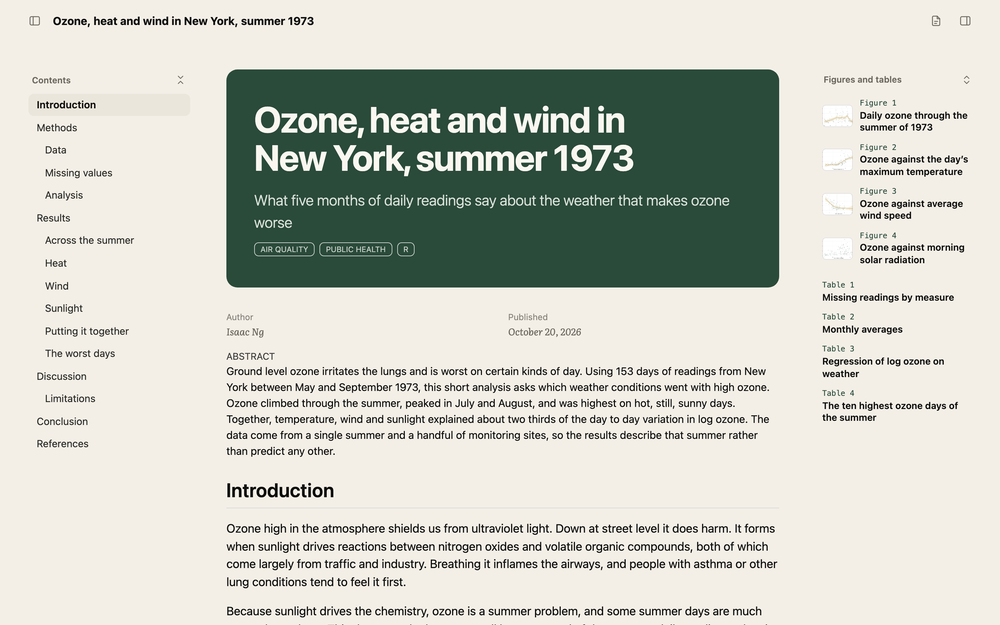
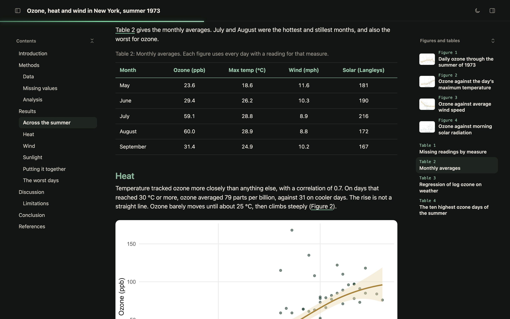

# folio

`folio` is a Quarto format for HTML documents. You write your `.qmd` or `.Rmd` exactly as before, and the page comes out easier to read and easier to move around.



What it adds to the HTML:

- The title stays pinned to the top, with a thin bar that fills as you read.
- Contents sit on the left. Every figure and table is listed on the right with a small thumbnail, and clicking one takes you straight to it.
- Each side has a button to hide it, and the text widens into the space.
- One button cycles between light, dark and paper colours. The page remembers the reader's choice.
- Data frames print as clean tables on their own, so there is no need to call `kable()`.
- Quarto's own title banner and lightbox are switched on, so figures open full size when clicked.

PDF and Word are left alone. `folio-pdf` and `folio-docx` are plain Quarto output.

## Installation

```bash
quarto add isaacng5/folio
```

This puts the extension in an `_extensions` folder inside your project. If you use version control, commit that folder too.

## Updating

Installed copies do not update themselves. Each project keeps the version it was given until you run:

```bash
quarto update isaacng5/folio
```

Then render again. Documents you have already rendered keep the look they were built with.

## Usage

Set the format in the YAML header:

```yaml
format: folio-html
```

Then render as you normally would, with `quarto render paper.qmd` (or `paper.Rmd`) or the Render button in RStudio or Positron. The Knit button for `.Rmd` uses R Markdown rather than Quarto, so it will not pick up folio.

To start a new document from the example instead:

```bash
quarto use template isaacng5/folio
```

## Options

- `folio-mode`: the colours a reader sees first. `light` (the default), `dark` or `paper`. Readers can still switch, and their choice wins.
- **Captions**: the first sentence of a figure or table caption becomes its title in the side panel, and the rest shows as the caption.

  ```r
  #| label: fig-ozone
  #| fig-cap: "Ozone against temperature. Each point is one day."
  ```

Everything else from Quarto's HTML format still works. folio only changes a few defaults (contents on the left, the title banner, lightbox, and `df-print: kable`), and you can override any of them in your own header, for example `title-block-banner: false`.

## Example

[`template.qmd`](template.qmd) is a short analysis of New York's ozone readings from the summer of 1973, using the `airquality` data that ships with R. It shows every part of the format: figures, tables, the side panels and all three colour modes.



## Licence

MIT
